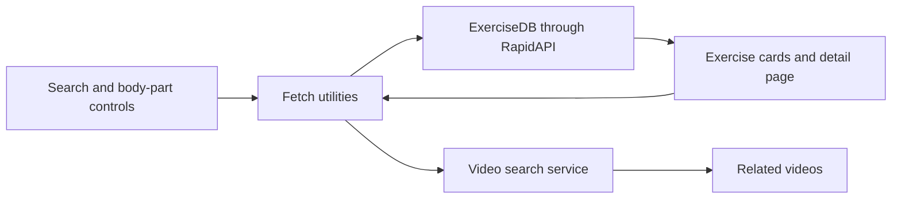

# BeFit · Exercise Explorer

**Find an exercise, inspect its equipment and target muscles, and explore related examples.**

React · Material UI · React Router · RapidAPI

## Purpose

Exercise information is easier to browse when search, movement details, and video references are connected. BeFit combines those views in a frontend project for exploring API-driven search and detail pages.

## Features

- Search exercises by name, body part, target muscle, or equipment.
- Browse body-part categories.
- Open a dedicated page for an exercise.
- Display related exercises by target muscle and equipment.
- Retrieve related video results through a separate search API.

## Setup

You need Node.js/npm and access to the RapidAPI services configured in [`src/utils/fetchData.js`](src/utils/fetchData.js).

From the source directory:

```bash
npm install
```

Set `REACT_APP_RAPID_API_KEY` in a local `.env` file, then start the frontend:

```bash
npm start
```

Visit [localhost:3000](http://localhost:3000). Restart the development server after changing environment configuration. `npm run build` creates the frontend bundle.

## Try it

Search for an equipment name such as `dumbbell`, select an exercise card, and inspect the detail view. Follow the related exercise cards or video links to continue exploring.

## Architecture



## Project structure

| Path | Role |
|---|---|
| [`src/App.js`](src/App.js) | Home and exercise-detail routing |
| [`src/Pages/`](src/Pages/) | Page composition and detail fetching |
| [`src/Components/`](src/Components/) | Search, cards, details, video, and related-exercise views |
| [`src/utils/fetchData.js`](src/utils/fetchData.js) | Endpoints, headers, and request helper |
| [`src/assets/`](src/assets/) | Interface images and icons |

## Integration boundaries

The app depends on provider access, response formats, and request quotas. Its current requests run in the browser, so `REACT_APP_RAPID_API_KEY` is visible in the built client; private provider credentials belong behind a server-side proxy in a public deployment. The project does not include personalized workout programming or a user-account backend.

Bootstrapped with [Create React App](https://github.com/facebook/create-react-app).
